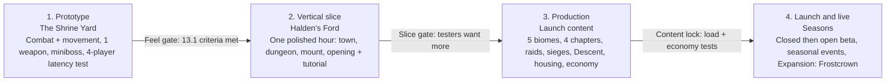

# Crownfall — Game Design Blueprint

Oct 27, 2026 · @REEHH

## Platform assumption

This blueprint assumes the game is built in **Roblox Studio** (the work is scoped to the place *Place1*), targeting PC (keyboard + mouse) first, then gamepad, then mobile touch. Every system below is designed to fit Roblox's server-authoritative model, 50–100-player servers, DataStore persistence and TeleportService for instanced content. If the target is a standalone engine instead, the design holds; only the networking and rendering notes change.

**Rendering decision (confirmed): the whole game is 2.5D pixel sprites in a 3D collision world.** The world is built from flat, pixel-textured planes and low-poly blockout geometry, viewed through a fixed, three-quarter orthographic-style camera. Characters, enemies and VFX are sprite-sheet billboards (ImageRectOffset frame stepping, nearest-neighbour filtering, 8 facing directions). This keeps real 3D physics, height and server hit-checks while the screen reads as pixel art. A pure 2D GUI renderer was rejected: it loses height, climbing and Roblox's physics for no gain.

**2.5D applies to every part of the game, not only the open world:**

- **Combat, climbing and parkour:** depth and height are real 3D; climbable walls are vertical faces in the 3D world. The camera keeps one fixed three-quarter angle in combat. Outside combat, in towns and houses, it can rotate in four 90° steps so nothing is hidden behind buildings.
- **Cutscenes:** in-engine and 2.5D. The camera moves on 3D rails (pans, push-ins, dollies through parallax layers) while character sprites stay billboarded and use cutscene-only poses.
- **Character previews:** creation and the equipment screen render the same layered sprite stack in a 3D viewport, turning through all 8 facings.
- **Housing:** props are pixel-textured meshes or sprite billboards placed on a 3D grid with height layers.
- **Mounts and dragon flight:** altitude reads through a ground shadow and a slight change in sprite scale. Flight stays inside a fixed height band so the camera never loses the rider.
- **Dungeons, raids, sieges and the Descent:** built from the same modular 2.5D kits as the overworld.
- **Title screen:** a 2.5D parallax diorama the camera tilts down through into the opening. The world map stays a flat, painted atlas, because it is an in-world document.

No game code was written and no Studio place was touched; this is design planning only.

Title: keep **Crownfall** as the franchise name. Recommended subtitle: **Crownfall: The Sundered Oath** — shorter, ties directly to the central story device (an oath that was broken and is being remade), and avoids the overused "sky" in the logo. Final call is listed under Open decisions.

## 1. High-concept pitch

**Crownfall is a multiplayer pixel-art action RPG where every fight is a duel of timing.** Three hundred years ago the Sky Throne fell out of the heavens and shattered the Aurelian Empire. Its pieces — the Shards — still lie buried under the old roads, and they are waking. You are an **Oathbound**: a mortal who survived touching a Shard and now carries a fragment of the broken imperial oath in your blood.

You parry, dodge, climb and ride across fractured kingdoms with friends, fight readable, punishing enemies whose posture you can break, raid the vaults beneath the ruins, defend towns in sieges, build a home, and decide which kingdom inherits the sky.

- **Feel:** deliberate, posture-driven melee — every enemy swing is a question, every parry an answer.
- **Look:** dense, lived-in pixel towns and ruins; cutscenes staged like hand-animated anime set pieces.
- **Play:** a shared world for parties of up to 4, raids for 6, sieges for 20+, and a roguelike Descent mode that is the purest test of the combat.

## 2. Target player experience and main loop

**The player should feel like a skilled duelist in a dangerous, beautiful world they share with friends.** Three feelings matter most, in order:

1. **Mastery** — "I lost because I misread that tell, and next time I won't." Deaths teach; gear helps but never substitutes for timing.
2. **Discovery** — every road bend, rooftop and ruin hides something drawn by hand: a story in the props, a climbable route, a secret shrine.
3. **Belonging** — a party that coordinates posture breaks, a guild hall, a house in a town you defended, a mount you raised.

**Target players:** fans of deliberate action combat (Souls-likes, Sekiro-style parry games) who also want an MMO-lite shared world; Roblox players aged 13+ who are ready for a skill game; groups of 2–4 friends.

### Core loops by time scale

| Scale | Loop | Example |
| --- | --- | --- |
| 30 seconds | Read tell → parry / dodge / block → build enemy posture → break → critical strike | A bandit captain's overhead swing: parry, parry, his posture shatters, execution |
| 10 minutes | Leave town → travel by road or rooftop → encounter (random or authored) → loot, materials, map knowledge → return, repair, craft | Escort a salt caravan through the Ashmarch, ambushed twice, earn a recipe |
| 1 session (1–2 h) | Pick a goal (quest chapter, dungeon, raid, Descent run, siege) → prepare (food, cures, repairs, powers) → commit → rewards feed build and home | Clear the Lantern Vault with friends, earn a mount quest token |
| Weeks | Chapter progress, weapon mastery, mount bonds, faction standing, housing, collections, regional control shifts after sieges | Your guild helps Varrow keep Halden's Ford; its shops unlock new stock |

The fight is the centre; every other loop exists to send the player back into a fight better prepared, in a new place, or alongside other people.

## 3. World, story, player role, factions, chapters

**Setting: the Sundered Reach, a continent built on the corpse of an empire that fell from the sky.** The Aurelian Empire ruled from the Sky Throne, a floating citadel bound aloft by the **Great Oath** — a pact between the first emperor and the Wardens, ancient beings sleeping beneath the earth. When the last emperor broke the Oath to seize the Wardens' power, the Throne fell. The impact carved the Scar, scattered glowing Shards across the land, and split the empire into feuding successor kingdoms connected only by the crumbling Old Roads.

Now the Shards are waking. Shardblight (a sickness), Hollowed beasts and walking ruins spread outward from them. Something under the Scar is trying to finish what the emperor started.

### Player role

You are an **Oathbound**. In the opening you survive contact with a Shard and gain a **Brand** — a fragment of the Great Oath that lets you parry things no mortal should, and attunes you to Shard powers. Oathbound are rare, feared and recruited by every faction. Your origin shapes how they first see you; your choices decide who you serve.

### Factions

| Faction | Who they are | Wants | Visual identity |
| --- | --- | --- | --- |
| Crown of Varrow | Largest successor kingdom; knights, bureaucrats, old imperial blood | Restore the empire under Varrow, rebuild the Throne | Lapis blue, gold leaf, heavy plate |
| The Ashen Compact | Free cities and merchant leagues of the southern ash plains | Keep the roads open and the crowns weak | Rust orange, canvas, caravan banners |
| Order of the Quiet Lantern | Monastic scholars who tend Shard sites and treat blight | Seal the Shards forever | Bone white, teal lantern-glass |
| The Thornborn | Forest clans displaced by the fall; guerrilla rangers | Reclaim ancestral land; distrust all crowns | Moss green, antler, woven bark |
| The Hollow Choir (antagonist) | Cult that hears the Wardens' voice through the Shards | Wake the Wardens and remake the sky | Violet void-light, cracked porcelain masks |
| Roadwardens (neutral) | Sworn keepers of the Old Roads, waystations and fast-travel beacons | Neutral passage for all | Grey cloaks, iron lanterns |

Players earn standing with all of them but pledge to **one of the four major powers** (Varrow, Compact, Lantern, Thornborn) at the end of Chapter 2. The pledge sets siege side, faction quests, gear lines and story perspective; it can be changed once per season at a cost.

### Chapter progression (launch = Prologue + 4 chapters)

| Chapter | Title | Region | Story beat | Ends with |
| --- | --- | --- | --- | --- |
| Prologue | The Rain at Saint Ivel's | Mirefen road + Halden's Ford | You touch a Shard and survive | Halden's Ford gate burns; first boss |
| 1 | Roads of Ash | Ashmarch plains | Track the Choir along the Old Roads; meet the factions | First story dungeon: the Toll Catacombs |
| 2 | The Lantern and the Crown | Varrow highlands + Lantern abbey | Factions bid for you; the Choir assassinates a regent | Faction pledge; first siege |
| 3 | Thornwake | Thornwood | Discover the Wardens are not gods but prisoners | Raid unlock: the Root Vault |
| 4 | Beneath the Scar | Scar rim + Sky Throne debris | Confront the Choir's Cantor; the Throne stirs | Cliffhanger: the Throne rises again |
| Expansion 1 | (post-launch) | Frostcrown north, sky islands | Who rebuilds the Oath, and on what terms | — |

### What choices can change (bounded branching)

Choices change **state, not story spines**. The main plot always reaches the same chapter endings; what changes is who stands beside you, which towns thrive and how characters treat you.

- **Personal state:** NPC relationships, unlocked side quests, dialogue, titles, faction standing, pledge.
- **Town state:** each named settlement has 3 states (Thriving / Strained / Fallen) driven by quest outcomes and siege results. State swaps NPC sets, shop stock and ambient props; it never deletes quest givers needed for the main story.
- **Regional control:** sieges and world events shift which faction holds a fort, changing patrols, encounter tables and taxes on homes nearby. This is shared server-wide per season, not per player.
- **Major choices:** 1–2 per chapter, each with 2–3 outcomes that set flags read by later chapters (e.g. spare or execute the deserter captain in Ch.1 → he appears in Ch.3 as ally or his widow as rival).

## 4. Combat and movement

**Combat is a posture duel: you win by breaking the enemy's guard through timing, not by draining health.** Health matters, but the fastest, safest and most rewarding path to a kill is reading tells, parrying, and landing a Critical on a broken enemy. All timings below assume 60 fps (1 frame ≈ 16.7 ms) and are tuning starting points for the prototype.

### 4.1 Resources

| Resource | Who | Fills / drains from | When it hits the limit | Recovery |
| --- | --- | --- | --- | --- |
| Health | All | Hits that land | Death (player: downed in co-op, see 6.1) | Consumables, rest at shrines, Warder powers |
| Stamina | Players | Sprint, dodge (25), light attack (8), heavy (18), climbing, blocking a hit (10) | Exhausted: 1.0 s slow walk, no dodge or sprint | Regenerates after 0.6 s of no stamina use, full in about 2.5 s |
| Posture | Players and enemies | Blocked hits, parried hits (attacker side), heavy hits, guard-pressure attacks | Posture Break (see 4.3) | Decays after 1.5 s without posture damage; faster at high health, slower at low health |
| Resolve | Players | Perfect parries (+20), Criticals (+30), landed hits (+3) | Max 100 | Spent on powers; slowly fades out of combat |

Stamina and Posture are deliberately separate: stamina limits *how much you can do*, posture tracks *how close you are to losing the exchange*.

### 4.2 The defensive verbs

| Verb | Input | Timing | Cost | Result | Weakness |
| --- | --- | --- | --- | --- | --- |
| Perfect Parry | Tap Guard as the hit lands | 10-frame window (167 ms) ending on impact; 6 frames for Twin Fangs, 12 for Sword & Shield | 0 stamina | No damage; attacker takes large posture damage; you gain Resolve; spark + chime | Mistimed tap = 18-frame recovery before you can tap again (stops mashing) |
| Block | Hold Guard | Any time | Stamina per hit + your posture rises | Absorbs 85–100% damage depending on weapon | Fills your posture; useless against unblockables; guard-pressure attacks punish it |
| Dodge | Dodge + direction | 12 invulnerable frames within a 24-frame roll | 25 stamina | Avoids everything incl. unblockables | Recovery frames at the end; enemies track repeated dodge directions |
| Step | Tap Dodge while locked on with Light armor | 6 i-frames, short | 15 stamina | Fast reposition, keeps attack chain | Light armor only |
| Deflect Counter (power) | Equipped power | Thrust-only window | Resolve | Breaks a thrust unblockable | Wrong attack type = you eat it |

The parry window is generous enough to learn but strict enough to matter. A **Late Parry** (within 4 frames after the window) counts as a block with a 50% posture discount, so near-misses still feel rewarded.

### 4.3 Posture, Breaks and Criticals

- **Enemy posture** rises from your parries (largest), heavy attacks, Breaker weapons (hammers, greatblades) and charged hits. Light attacks add little posture but stop posture decay.
- **Posture Break (enemy):** the enemy staggers for 1.5 s (bosses 2.0 s) with a cracked-shield icon and a white flash outline. Any player can trigger a **Critical** (prompted with the Attack button) for heavy damage and Resolve. Normal enemies usually die to a Critical; elites lose a large chunk; bosses lose one health segment.
- **Player posture** rises from blocking, Late Parries and guard-pressure attacks. When full: **Guard Broken** — 0.9 s stagger, and the enemy may use a follow-up. Players are never executed outright; enemy follow-ups deal heavy damage, not instant death.
- **Readability:** posture is a thin bar *under* the health bar that grows from both ends toward the centre; at 80% it pulses amber. Bosses show posture under their name; trash enemies show it only after they take posture damage.
- **Co-op scaling:** each extra player attacking the same enemy adds 60% posture per hit (diminishing), and parries always deal full posture. A party that parries wins faster than a party that swarms.

### 4.4 Attack telegraph language

Every enemy attack belongs to exactly one category, signalled by a colour **and** a shape **and** a sound (so it works for colour-blind players and in noisy co-op fights).

| Category | Visual | Sound | Correct answers | Wrong answer |
| --- | --- | --- | --- | --- |
| Standard | White glint on the weapon at windup | Short metallic ring | Parry, block, dodge | — |
| Guard-Pressure | Amber chevron above the head + weapon trail thickens | Low drum hit | Parry or dodge | Block: drains most posture, likely Guard Broken |
| Unblockable — Sweep | Red sigil, horizontal bar shape | Rising whistle | Dodge through or jump | Block or parry |
| Unblockable — Grab | Red sigil, open-hand shape | Bone crack | Dodge sideways, or hit the enemy to interrupt during windup | Block or parry |
| Unblockable — Thrust | Red sigil, arrow shape | Sharp intake hiss | Dodge sideways or Deflect Counter (power) | Block or backward dodge |
| Unblockable — Spell / Area | Red ground ring that fills inward + sigil on caster | Choir hum building in pitch | Leave the area, interrupt the caster, stand behind cover or inside a Ward | Standing still |

Rules that keep unblockables fair: windup is at least 450 ms (bosses 600 ms); a sigil never appears off-screen without an edge-of-screen arrow; no unblockable is chained directly into another without a 0.5 s gap; every unblockable has a visible safe space or answer.

### 4.5 Block breaks and guard pressure on both sides

- **Enemies break players** by stacking guard-pressure attacks and long combos into a holding player. The answer is to stop holding block: parry the pressure hits or dodge out.
- **Players break enemies** with heavy attacks, charged attacks (hold Attack, 0.8 s), shield bashes and Breaker powers. Shield-bearing enemies have a separate **Shield Guard** that must be broken first (shield cracks visually in 3 stages).
- **Guard Broken** players get one clear punish attempt from the enemy; the first follow-up after a break is always a Standard-category attack, so a recovering player can still parry it.

### 4.6 Weapons (launch: 6 families)

| Weapon | Reach | Speed | Posture damage | Defence identity | Play style |
| --- | --- | --- | --- | --- | --- |
| Longsword | Medium | Medium | Medium | Standard parry (10 f) | Balanced duelist; the prototype weapon |
| Sword & Shield | Short | Medium | Low (bash: high) | Best block (100%), wider parry (12 f) | Vanguard: holds attention, protects allies |
| Spear | Long | Medium-slow | Medium | Thrust parry stance (counters Thrust unblockables) | Spacing, sweeps groups, mounted bonus |
| Greatblade | Long | Slow | Very high | Hyper-armour on heavy swings; weak block | Breaker: trades hits to crush posture |
| Twin Fangs | Short | Very fast | Low | Narrow parry (6 f), extra dodge Step | Striker: bleed, backstabs, evasive |
| Lantern Catalyst | Ranged (spells) + short knife | Varied | Low (spells: medium) | Parries with a Ward pulse (8 f) instead of a blade | Warder: casts, cleanses, supports; can still duel |

Each family has 3–4 movesets (light chain, heavy, charged, sprint attack, plunge attack from ledges, mounted attack) and weapon arts unlocked by **Weapon Mastery** (see section 5).

### 4.7 Powers

**Players equip 3 powers, spent from Resolve with short cooldowns.** Powers add tactics; they never replace parrying and dodging.

| Type | Example | Function |
| --- | --- | --- |
| Counter | Oath Riposte | Next perfect parry within 3 s triggers an instant Critical-lite |
| Ward | Lantern Ward | A 2.5 m dome for 3 s that absorbs Spell/Area unblockables for allies inside |
| Mobility | Shardstep | A 6 m blink-dodge with i-frames; can cross gaps |
| Elemental strike | Cinder Edge | Coats the weapon for 8 s; burning raises posture damage |
| Breaker | Sundering Blow | A slow overhead that deals huge posture damage; is itself parryable by enemies |
| Support | Rallying Cry | Restores 20% posture to nearby allies |
| Deflect | Thrust Deflect | Answers Thrust unblockables |

Powers come from the Brand (story), faction trainers, Descent unlocks and raid drops. Loadouts are free to change at shrines and homes.

### 4.8 Enemy AI

**Enemies are coordinated by an encounter Director that hands out attack tokens.** At most 2 enemies may actively attack one player at once (3 on Hard areas); others circle, flank or support. This keeps groups dangerous but parryable.

Behaviour modules, mixed per enemy type:

- **Spacing:** keeps preferred range; backs off from heavy weapons, closes on casters.
- **Flanker:** moves to the player's back while an ally holds attention.
- **Opportunist:** punishes healing, casting, exhaustion and Guard Broken states (sprints in during a drinking animation).
- **Reader:** tracks your last 5 defensive actions; if you dodge the same direction or parry-spam, it switches to delayed swings, feints or a sweep. It tells you it is adapting with a visible taunt or stance change.
- **Guardian:** shields a caster or banner bearer; must be broken or bypassed.
- **Support:** heals, buffs, raises posture of allies, or calls reinforcements (limited to once per fight).
- **Coward / Morale:** bandits flee at low morale when the leader dies, creating chase moments instead of grinding.

**Bosses** have 2–3 phases, each introducing one new mechanic. Every boss move has a unique silhouette pose on its windup frame. Party mechanics include split aggro (two targets marked by sigils), interrupt windows that need two players, and posture shields that only break when allies hit opposite sides.

### 4.9 Network fairness (Roblox)

- Enemy attacks are server-scheduled. The server broadcasts the windup start with a timestamp *before* the hit lands, so every client sees the tell early.
- **Parry and dodge are judged favouring the defender:** the client judges its own timing against the scheduled impact; the server accepts it if consistent within the player's measured latency, capped at 150 ms.
- Player hits on enemies: client proposes, server verifies with lag compensation of up to 200 ms of position history.
- Players above 250 ms ping get a gentle warning and wider windows in open world only, never in Descent leaderboards.

### 4.10 Movement kit

| Action | Input | Notes |
| --- | --- | --- |
| Walk / run | Move | Run is default speed; walk is analogue or a toggle |
| Sprint | Hold Sprint | Drains stamina slowly; auto-vaults low obstacles |
| Dodge / roll | Dodge | Direction-relative; out of combat a roll-landing cancels fall damage if timed |
| Jump | Jump | Short hop; required for gaps and Sweep unblockables |
| Vault / mantle | Contextual while moving | Waist-high: vault; chest-high: mantle |
| Ledge grab | Automatic when falling near a marked ledge | Can pull up, shimmy or drop |
| Climb | Jump onto a climbable surface | See 4.11 |
| Wall-run | Sprint along a marked wall | Max 1.2 s; only on marked surfaces |
| Rope slide / zipline | Interact | Fast routes downhill in towns and canyons |
| Mount / dismount | Mount button | Summon, ride, dismount-attack |

**Mode transitions:** exploration → combat happens when an enemy aggroes: soft-lock activates, wall-run is disabled, vaulting stays. Climbing in combat is allowed, but no attacks while climbing except a **plunge attack** off a ledge. Mounting is blocked for 3 s after taking damage so mounts are not a panic button.

### 4.11 Directional climbing

**Climbable surfaces share one visual code across the whole game:** pale chalk handholds, thick ivy, carpenter scaffolds and rope nets. If it is marked, it is climbable; if not, it is not.

- **Enter:** jump or walk into a marked surface.
- **Move:** up, down, left and right along the surface plane at about 40% run speed; diagonal allowed.
- **Corners:** outside corners wrap automatically when the surface continues; inside corners transition on input toward the next face.
- **Ledges:** pull up at the top; shimmy along ledges; drop to a ledge below with Down + Jump.
- **Grip:** climbing drains stamina slowly (hanging still drains less). At 0 the character slips 1 m and must grab again; at 0 twice they fall. **Rest ledges** (marked with a carved notch) refill grip.
- **Exits:** Jump + direction leaps away (can chain to another surface or a zipline); Crouch drops straight down; a timed roll on landing negates fall damage up to 12 m.
- **Hazards:** archers, falling rocks and wet stone in rain (faster grip drain) add pressure without becoming instant death.

### 4.12 Parkour and level guidance

Parkour is concentrated in **Runner Routes** — optional paths across rooftops, ruins, cliff faces and bridges, marked in the fiction by the Couriers' Guild with **blue ribbons** on poles and chimneys. Main quest progress never requires a route unless the quest explicitly says so and the route is short and easy.

Level layouts guide players with sightlines (a visible rooftop chest), lighting (a lit window on a climbable tower), wildlife (birds lifting off a ledge) and the ribbon language. Biomes use 10–20% of their space for vertical play; the rest stays readable ground-level exploration.

### 4.13 Readability in pixel art and co-op

- **Draw-order priority:** enemy telegraphs > your character > enemies > allies > environment VFX > ally VFX.
- **Ally VFX** default to 45% opacity and desaturated; your own VFX are full. Players can tune both.
- **Silhouette first:** every enemy windup frame is drawn as a distinct pose readable at 1× zoom without colour.
- **Hit-stop:** 3–5 frames on parries and Criticals so impact reads even in chaos.
- **Camera:** pulls back by up to 20% when 4+ enemies or allies are on screen; never shakes during an unblockable windup.

## 5. Character, equipment, powers, durability, inventory

**There are no locked classes: your build is the weapon you master, the armour weight you wear and the 3 powers you equip.** Roles emerge from those choices and can be changed at any shrine or home.

### 5.1 Character creation

Creation happens before the opening so your character appears in the first cutscene.

- **Body:** 4 body frames × 3 heights, drawn as separate sprite bases so every armour piece fits each one.
- **Face and head:** 12 face shapes, 30 hairstyles, eye styles, scars, tattoos, facial hair; all recolourable from curated palettes (no free RGB, so pixel art stays coherent).
- **Brand mark:** choose where your Oath Brand glows (hand, eye, neck, back) and its colour; it lights up in cutscenes and on perfect parries.
- **Voice:** 6 grunt and battle-cry sets.
- **Preview:** the character stands at the Saint Ivel's shrine in rain, lit like the opening, so players see their hero in the real game lighting.

### 5.2 Origins

| Origin | Start | Early dialogue and faction effect | Starting kit |
| --- | --- | --- | --- |
| Varrow Squire | Highland garrison | Knights trust you; Thornborn are wary | Longsword, Sword & Shield option |
| Compact Caravaneer | Salt road convoy | Merchants offer better first prices; you know road gossip | Spear, trade map of the Ashmarch |
| Lantern Novice | Abbey infirmary | Can read Shard script; disease starts better understood | Lantern Catalyst |
| Thornborn Exile | Forest edge camp | Thornborn quest line opens early; Varrow guards suspicious | Twin Fangs |
| Roadborn Orphan | Waystation | Neutral; unique Couriers' Guild quests and a parkour head start | Greatblade (salvaged) |

Origins add a unique prologue scene, 2–3 exclusive side quests and dialogue options throughout. They never lock players out of weapons.

### 5.3 Progression of the character

- **Level (1–50 at launch):** small health and stamina gains plus **Attribute points** (Might, Finesse, Endurance, Insight). Levels gate gear tiers and regions softly; skill always beats level.
- **Weapon Mastery (per family, 10 ranks):** earned by *using* the weapon, with bonus mastery for perfect parries and Criticals. Unlocks weapon arts, alternate combos and cosmetic weapon glows.
- **Disciplines:** four loose role tracks (Vanguard, Breaker, Striker, Warder) that unlock passives as you complete role challenges. Equip one Discipline at a time.
- **Brand Awakenings:** story-gated upgrades to the Brand (one per chapter) that unlock new power slots and abilities like the Shardstep.

### 5.4 Item categories

| Category | Examples | Notes |
| --- | --- | --- |
| Weapons | 6 families, 5 tiers, named uniques | Durability, mastery-linked |
| Armour | Head, chest, hands, legs, feet; Light / Medium / Heavy | Weight sets dodge type and stamina cost |
| Accessories | Ring ×2, amulet, charm | Effects, not raw stats |
| Powers | Learned, not items, but taught by Tomes | Tomes are tradeable once |
| Consumables | Tonics (heal), salves (posture), cures, food buffs, throwables | Limited belt slots (4) |
| Materials | Ore, hide, herbs, Shard dust, boss trophies | Regional |
| Tools | Pick, sickle, skinning knife, climbing hook | Gathering and traversal upgrades |
| Quest items | Letters, keys, relics | Separate tab, no weight |
| Cosmetics | Outfits, weapon skins, dyes, mount tack, emotes | Transmog over any gear |
| Housing items | Furniture, props, trophies | Go to house storage |

**Rarity:** Common, Fine, Masterwork, Relic, Oathforged. Higher rarity adds effect slots, not huge raw numbers, to keep the skill ceiling meaningful.

### 5.5 Gear sets and synergies

Sets give **2-piece and 4-piece bonuses that reward a play style** instead of raising numbers. Mixing pieces is always viable.

- *Duelist's Vow (Light):* perfect parries refund 10 stamina; 4-pc: first Critical in each fight gives a short haste.
- *Bulwark of Varrow (Heavy):* Guard Broken lasts 30% shorter; 4-pc: blocking an ally's attacker taunts it.
- *Lanternkeeper (Medium):* ward powers last 1 s longer; 4-pc: cleansing an ally restores your Resolve.

### 5.6 Durability

**Recommended scope: weapons and armour have durability; tools wear slowly; mounts use stamina and injury instead.**

- **Wear:** weapons lose durability per hit landed and per block; heavy blocks and Guard Breaks cost extra. Perfect parries cost almost none (skill is rewarded). Armour wears when you take hits.
- **Display:** a small pip ring on the weapon icon in the HUD; the item card shows exact numbers.
- **Warnings:** at 25% the icon turns amber and a short whisper plays; at 10% a one-line toast. At 0% the item becomes **Dulled**, never broken: −40% damage and posture damage, but still usable. You never lose a favourite weapon.
- **Repair paths:** smiths in every town (gold); **Field Whetstones** (crafted, restore 30%); home workbench (materials, full repair); Warder-allies with the Mender power can restore 10% to party gear.
- **Typical pacing:** a weapon lasts roughly 2 dungeons or 60–90 minutes of open-world fighting before needing repair.

### 5.7 Inventory and equipment interface

**The equipment screen is built around a live, animated preview of your character.**

- **Layout:** left — equipment slots around the paper doll; centre — large live preview (rotate 8 directions, idle animation, plays the weapon's ready stance when a weapon is hovered); right — item grid with tabs.
- **Inspect:** hover or select any item to see a card: art, rarity, stats, effects, set bonus, durability, binding, value, lore line. Comparison arrows (green up, red down) against the currently equipped piece.
- **Equipping:** the preview swaps the piece with a 0.25 s shimmer and a short pose (draws the sword, settles the cloak); stats tick to new values.
- **Organisation:** sort by type, rarity, level, newest, durability; filters; favourites (star = protected from selling and salvaging); a search box on PC.
- **Inspect others:** you can view another player's *equipped* gear, cosmetics and titles; never their bags or storage.
- **Input:** mouse (drag and click), keyboard (number keys for tabs), gamepad (bumpers swap tabs, D-pad moves the grid, Y to compare), touch (tap to inspect, hold to equip, larger hit targets).
- **Capacity:** weight-free slot bags (60 slots at start, expandable through crafting and quests); materials go into a separate, larger materials pouch to avoid clutter.

## 6. Multiplayer, parties, bonds, raids, sieges, social

**The shared world is a set of regional servers (about 40 players each) plus private instances for dungeons, raids, Descent runs and story moments.** On Roblox this maps to one place per region and reserved servers via TeleportService for instances.

### 6.1 Parties

- **Size:** up to 4 in the open world and dungeons; raids combine into a 6-player raid group; sieges take up to 24 per side.
- **Inviting:** from the friends list, by clicking a player, or through a **Notice Board** in each town for posting open parties ("Lantern Vault, need Vanguard").
- **Party frame:** portrait, health, a slim posture bar (only shown in combat), ailment icons, Dulled-weapon icon, distance arrow when off-screen, and a downed marker.
- **Downed, not dead:** at 0 health in a party a player is **Downed** for 20 s; an ally holds Interact for 3 s to revive (interruptible). Solo players respawn at the last shrine.
- **Pings:** a radial ping wheel ("Attack here", "Break this one", "Need revive", "Danger"); pings show on the minimap.

### 6.2 Drop-in and story pacing

- Anyone can join a friend's world region at any time. Main-quest **story scenes play for the quest owner**; joiners watch as guests and get a "Helped a friend" reward, but their own story progress is unchanged.
- **Shared objectives:** open-world kills, gathering and side-quest steps count for all party members who have the quest.
- **Level sync:** higher-level players are scaled down to the region's band for fairness; they keep their powers and skill.
- Story dungeons can be replayed in **Echo mode** to help friends after completion.

### 6.3 Bonds

**Bonds are named, levelled relationships that grow by doing things together and grant shared perks and cosmetics.** No companion characters are included.

| Bond type | Formed by | Grows from | Rewards |
| --- | --- | --- | --- |
| Oathsworn (player–player) | Both players swear at a shrine (max 3 per player) | Fights won together, revives, co-parries on the same enemy within 1 s | Shared fast travel to each other, a duo emote, a joint Critical finisher at rank 5, matching Brand colours |
| Guild Banner | Joining a guild | Guild goals, sieges, contributions | Guild hall upgrades, banner cosmetics, guild titles |
| Faction Standing | Quests, sieges, gifts | Faction work | Gear lines, vendors, faction mounts, story scenes |
| Mount Bond | Riding, feeding, grooming, fighting together | See section 7 | Mount skills and appearances |
| Town Bond | Helping a settlement (quests, defence, buying local) | Town state | Discounts, unique house plots, local festival roles |

### 6.4 Guilds

- Up to 100 members, ranks with permissions, a guild bank with logs.
- **Guild Hall:** a buildable instance near a capital, decorated with the same tools as player housing.
- **Weekly Guild Contracts:** shared goals ("Defend 3 caravans", "Clear the Root Vault 5 times") that pay guild currency for hall upgrades and banner cosmetics.
- Guilds enter sieges as a group and get named on the fortress banner when they hold it.

### 6.5 Raids

**Raids are repeatable 6-player, 3–4 stage dungeons with a final boss built around coordination.** Launch ships with 2 raids; one more per content update.

*Example — The Root Vault (Chapter 3):*

1. **The Drowned Hall:** waters rise every 90 s; players climb pillars between fights while Root Hounds attack. Teaches climbing under pressure.
2. **The Seed Engine:** two levers on opposite sides must be pulled within 2 s while guardians protect them. Splits the group.
3. **Warden's Antechamber:** a mini-boss pair that share one posture bar; breaking it needs both to be parried in turns.
4. **The Bound Warden:** a 3-phase boss. Phase 1 teaches its tells; phase 2 marks two players with Thrust unblockables that only a Deflect or a sidestep answers; phase 3 floods the arena with Area spells, and Ward powers create the only safe zones.

Raid rewards: Relic gear, set pieces, crafting cores, cosmetics, a raid title, and a 2% chance (pity-protected at 30 clears) to drop a mount quest item.

### 6.6 Sieges

**Sieges are scheduled 30-minute battles (24 vs 24 players plus NPC armies) for named forts that change regional control for a week.** Players fight on their pledged faction's side; NPCs fill empty slots so sieges always run.

| Role | Objectives (attack) | Objectives (defence) |
| --- | --- | --- |
| Vanguard | Hold the battering ram, push the gate | Hold the gate and breaches |
| Sapper | Plant charges on walls, climb siege ladders | Destroy ladders, repair walls |
| Saboteur | Disable defending ballistae and braziers | Destroy siege engines in the field |
| Warder | Shield the ram team, revive | Cleanse fire, revive, heal walls |
| Rescuer | Free captured scouts for spawn points | Evacuate villagers for score |

Phases: Approach (field fights) → Breach (gates and walls) → Inner Court (capture 3 points) → Keep (boss-like commander duel). The winner holds the fort: its region gets that faction's patrols, shop discounts for its members and lower house taxes.

**Fairness:** duelling between players in sieges uses the same parry rules, but players deal 50% damage to other players and player-on-player posture breaks last half as long to avoid lock-downs. Open-world PvP is off at launch.

### 6.7 World events and social spaces

- **Hunts:** a roaming elite beast appears in a region; everyone nearby can join, rewards scale with contribution.
- **Traveling merchants:** rare stock, appear with a horn call and a map icon for 20 minutes.
- **Festivals:** seasonal (Lantern Night, Harvest of Ash) with mini-games, outfits and dance emotes.
- **Regional monster attacks:** waves strike a town; failure moves the town to Strained for 24 h.
- **Social hubs:** taverns with seating, music, card game (Crowns & Ravens, an original mini-game), notice boards, housing districts.

## 7. Mounts

**Mounts are collected, bonded and raised; each family has one travel strength and one restrained utility, and none can fight a battle for you.** Dragons sit at the top of the collection as a long, prestigious goal.

### 7.1 Mount families

| Family | Rarity | Travel strength | Utility ability (cooldown) | Limits | How obtained |
| --- | --- | --- | --- | --- | --- |
| Roadhorse | Common | Fastest on roads (+25% road speed) | Trample: knocks small enemies down (20 s) | Slow off-road in marsh and forest | Stables, Chapter 1 quest |
| Ash Strider (two-legged lizard) | Common | Sand and ash dunes, heat immune | Sprint burst (30 s) | Hates cold biomes | Compact stables |
| Thornwolf | Uncommon | Forest paths, climbs gentle slopes | Howl: reveals nearby hidden enemies (60 s) | Fragile; injured easily | Thornborn bond quest |
| Ridge Ram | Uncommon | Mountain ledges and steep slopes | Leap up one marked ledge | Slow on flat ground | Varrow highland quest |
| Gale Roc (giant bird) | Rare | Glides from heights, short flaps | Glide only (cannot climb altitude freely) | Glide only; cannot carry into dungeons | Egg from a high-cliff nest, hatched at home |
| Lantern Stag (mythical) | Rare | Night travel, lights dark caves | Cleanse a nearby ally of Shardblight (5 min) | Fragile in combat | Lantern abbey epic quest |
| Skywyrm (dragon, mythical) | Very rare | True flight between Roost beacons, scenic flight in open regions | Wing gust knocks back non-boss enemies (90 s) | No flight in combat zones, towns, sieges or dungeons; lands at Roosts only | Long questline (below) |

### 7.2 Earning and bonding

- **Finding:** wild mounts roam certain regions; you approach quietly, calm them with a timed mini-game (match the animal's breathing rhythm) and lead them to a stable. Rare mounts come from quests, raids, eggs and reputation.
- **Bond (rank 1–10):** rises by riding, feeding favourite foods, grooming at stables or home, and fighting nearby. Ranks unlock stamina, ability upgrades, a call-whistle range, and unique tack and coat variants.
- **Injury instead of durability:** a mount hit too often becomes **Injured** (slower, no ability) until rested at a stable or home or treated with a poultice. It never dies permanently.
- **Summoning:** whistle from any outdoor area; the mount runs in from off-screen within 3 s. No summoning indoors, in combat (3 s after damage) or in instanced dungeons.
- **Customisation:** saddles, barding, coat dyes, mane styles, ribbons, lanterns; all cosmetic, earned from play, crafting and events.

### 7.3 Dragons as the rare mythical mount

The **Skywyrm** questline unlocks after Chapter 4 and takes several weeks of play:

1. Find a cold dragon egg in the Scar (exploration secret, any party member can find it).
2. Keep it warm at your house's hearth for 7 real days while completing heat-gathering tasks across 3 biomes.
3. Raise the hatchling (a small pet that follows you at home) through 5 bond trials, one of them a raid-difficulty duel against its mother.
4. Earn a Roost Charter to fly between Roost beacons.

Only a small share of players will finish it, so a dragon is visible proof of commitment. Recolours and new dragon breeds arrive with expansions.

### 7.4 Mounts and the rest of the game

- **Roads:** horses get road speed; caravans and patrols use the same roads, so riding fast also means meeting ambushes (a dismount-attack is the opener).
- **Parkour and climbing:** mounts cannot climb walls or use Runner Routes; Ridge Rams and Rocs handle specific marked terrain only. Required traversal is always on foot.
- **Combat:** mounted players can do a light attack and a charge attack; enemies with spears and nets can dismount you. Bosses and elites can't be fought mounted.
- **Party travel:** larger mounts (Ash Strider, Roadhorse with a cart upgrade) carry one passenger. **Ride Together:** party members can follow the leader with auto-path on roads.
- **Map:** the map shows each mount's terrain strengths, and Roost beacons appear only for dragon riders.

## 8. Biomes, weather, disease, encounters, NPCs, maps, exploration

### 8.1 Biomes (launch: 5)

| Biome | Level band | Palette | Culture | Signature enemies | Hazards | Resources | Exploration reward |
| --- | --- | --- | --- | --- | --- | --- | --- |
| Mirefen | 1–10 | Wet greens, slate, candle gold | Fishing villages, roadside shrines | Bog bandits, mire crawlers, drowned pilgrims | Sinking mud, leeches | Reeds, peat, eel oil | Shrine relics, first Runner Route |
| Ashmarch | 10‒20 | Rust, ochre, ash grey | Compact salt towns, caravans | Raider gangs, dune scorpids, glass hounds | Ash storms, heat | Salt, glass sand, scorpid chitin | Buried caravan wrecks |
| Varrow Highlands | 18–30 | Lapis, cold stone, gold | Castles, terrace farms | Deserter knights, ridge trolls, rams | Cliffs, cold winds | Iron, highland wool | Castle rooftops, fortress sieges |
| Thornwood | 28–40 | Moss, amber, deep teal | Thornborn tree villages | Root hounds, Hollowed stags, thorn witches | Spore pockets, darkness | Heartwood, spores, antler | Canopy parkour, hidden groves |
| Scar Rim | 38–50 | Violet void, white stone, star-sky | Choir camps, imperial ruins | Choir zealots, Shard golems, voidlings | Shardblight fields, low gravity spots | Shard dust, star iron | Floating Throne debris, dragon egg |

**Preparing for harder regions:** each region border has a Roadwarden waystation with a **Threat Plaque** (difficulty tier 1–5 shown as cracked crowns), local warnings from NPCs, and a vendor selling that biome's cure and resistance items. Entering early is allowed; enemies' skull icons warn you.

### 8.2 Weather

**Weather is regional, visible ahead (clouds on the horizon, a map forecast) and changes 2–3 things at most per type.**

| Weather | Atmosphere | Traversal effect | Combat effect |
| --- | --- | --- | --- |
| Rain | Puddle reflections, drips on sprites | Wet stone drains grip faster | Fire powers weaker; lightning stronger |
| Fog | Layered fog sprites, muted sound | Shorter view distance, hidden paths revealed | Ambushes more likely; enemy tells still drawn bright |
| Ash storm | Orange haze, blowing particles | Slower travel, mounts uneasy | Ranged attacks less accurate |
| Snow / cold wind | Snow layers, breath puffs | Stamina regen slower without warm gear | — |
| Shard Aurora (rare) | Violet sky ribbons | Hidden Shard sites glow | Choir enemies empowered; extra rewards |

Telegraphs, posture bars and unblockable sigils are never hidden by weather.

### 8.3 Disease: Ailments

**Ailments are short, preventable survival puzzles, not long punishments.** Each lasts until cured or naturally fades within 30–60 minutes of play.

| Ailment | Caught from | Effect | Prevention | Cure |
| --- | --- | --- | --- | --- |
| Marsh Fever | Mirefen water, crawler bites | Stamina regen −15% | Boiled water, fever charm | Willowbark tea (craft), any healer |
| Ash Lung | Ash storms without a mask | Sprint drains faster | Cloth mask (cheap) | Honey tincture |
| Rot Spore | Thornwood spore pockets | Slow health drain in combat | Spore-ward salve | Burn ritual at camps, Lantern Stag |
| Shardblight | Shard fields, voidling hits | Builds in 3 stages: visual cracks, then −10% max health, then power cooldowns slower | Warding tonics, shelter during Aurora | Lantern abbey, Lantern Ward power, Mender allies, home infirmary upgrade |

Ailments never stop you from playing. They show as one icon each on the HUD with a tooltip listing every cure, and a party Warder can cure allies, which gives support players a clear job.

### 8.4 Random bandit and monster encounters

**An Encounter Director per region spawns contextual events around players instead of at them, using the region's encounter table, time of day, weather and faction control.**

**Spawn rules**

- Spawn 40–80 m away, out of the camera view, never in safe zones (towns, shrines, waystations), never within 25 m of a recent spawn point.
- **Cooldowns:** at most one random encounter per party every 3–5 minutes of travel; no new encounter while the party is already in combat or within 60 s of a previous fight.
- **Scaling:** group size and elite chance scale with party size (solo: 2–4 enemies; party of 4: 5–8 plus maybe an elite) and the region's band. Level-synced players never face enemies above the region band.
- **No repetition:** encounter types are drawn from a weighted deck; the same type cannot repeat for a player within 3 draws.

**Discovery cues** appear 10–20 s before contact: tracks on the road, smoke from a camp, crows lifting off, a distant scream, a broken cart, a horn call. Players can avoid, ambush or engage.

| Encounter type | Example | Threat | Notes |
| --- | --- | --- | --- |
| Ambush | Bandits jump from roadside reeds | Medium | Cue: bent reeds, a glint |
| Patrol | 3 Varrow deserters walking the road | Low–medium | Can be avoided or talked down with high standing |
| Nest | Scorpid burrows near a cliff | Medium | Clear for materials |
| Elite | Named bandit captain with a bounty | High | Bounty board rewards |
| Roadside trouble | Caravan under attack | Medium | Saving it raises Compact standing and town supply |
| Migration | Herd of Hollowed stags crossing | Variable | Avoidable, rare materials |
| Rare sighting | A Shard Golem walking at dusk | Very high | Map-wide shout; group content |

**Effects on the world:** uncleared encounters near roads lower a town's supply over time (higher shop prices, Strained state risk). Caravans saved raise supply. Faction control changes which bandit and patrol types appear.

**Rewards without grind:** each encounter type gives its bulk reward (materials, gold, bounty marks) for the first few per hour per player, then only small drops. Unique rewards come from elites, rare sightings and bounties.

**Coexistence:** the Director pauses random spawns inside authored quest areas while a quest step is active, during sieges in the siege zone, and in raid and dungeon instances.

### 8.5 NPCs and environmental interaction

- **Routines:** named NPCs follow 4 time blocks (morning, day, evening, night): work, market, tavern, home. Their schedule appears in their character entry once you've met them.
- **Loyalties and concerns:** each named NPC has a faction, a worry tied to local state ("The Ford bridge is out again") and dialogue that reacts to town state, sieges and your choices.
- **Interaction:** sit, read notes, ring bells, light lanterns, push carts to make bridges, cut ropes to drop drawbridges, open shutters for light, pet animals, play instruments, examine murals for lore.
- **Environmental storytelling:** each ruin tells a small story through props (a child's toy by a barricaded door, a soldier's last letter); a **Lore Journal** collects these.

### 8.6 Maps and navigation

- **World map:** a hand-painted pixel atlas. Regions are tinted by biome; difficulty shows as cracked-crown icons on borders; roads, settlements, dungeons, raid gates, sieges and known hazards each have one icon.
- **Discovery:** the map starts as parchment outline. You fill it in by walking (fog of war lifts), climbing **Vista points** (reveals icons in a radius), buying charts from cartographers, reading signposts, and from quest-givers who mark places.
- **Local maps:** dense towns, multi-level ruins and dungeons get a separate layered local map (toggle floors).
- **Party and objectives:** party members show as coloured pins with a facing arrow; the active quest gets a compass marker; other quests are dim until tracked. Events pulse on the edge. A **filter bar** hides categories.
- **Traversal markings:** Runner Routes show as dotted blue lines after you find their start; climb surfaces show as hatching only on the local map, so the world map stays clean.
- **Minimap:** small, top-right, north-up or rotating; can be hidden.
- **Fast travel:** Roadwarden beacons in every settlement and a few road waystations; costs a small fee, free to your home town. Dungeons and Runner Routes have no beacons, so mounts and roads stay useful.

## 9. Quests, tutorial, Descent and repeatable content

### 9.1 Main quests

Each chapter is **6–8 main quests** ending in a story dungeon or siege, with 2–3 cinematic cutscenes and one major choice. Main quests mix combat, exploration, investigation (examine clues in a scene) and at least one traversal set piece per chapter (a rooftop chase in Halden's Ford, a collapsing bridge in the Highlands).

Story dungeons are hand-authored, 20–30 minutes, playable solo or with up to 4, and end with a boss that tests the chapter's newly learned skill (Ch.1 boss tests guard pressure, Ch.2 tests Thrust unblockables, Ch.3 tests climbing during a fight, Ch.4 tests everything).

### 9.2 Side quests

**Rule: every side quest has a person, a place and a twist.** Fetch steps exist but are never the point.

- *The Ferryman's Debt (Mirefen):* help a ferryman repay bandits, then discover his debt is to his own son's gang. Choice: turn the son in, or help him leave. Town state and a later bounty change.
- *Glass Hounds Don't Bark (Ashmarch):* investigate missing caravan dogs; find glass-sand mutation from a buried Shard. Unlocks a crafting recipe for glass armour.
- *A Knight Without Colours (Highlands):* duel a deserter knight who will only talk after you beat him without being hit more than twice (a skill-based condition with a gentler fallback after 3 failed attempts).
- *The Choir in the Chimney (Halden's Ford):* a Runner Route mystery across rooftops to find who is ringing bells at night.

Side quests are grouped in local **story clusters** (3–5 linked quests per town) so they build into something bigger, like saving a town from Strained state.

### 9.3 Tutorial

The tutorial is the opening (section 11.2): **about 8 minutes, playable, no text walls**. Prompts appear only the first time a verb is needed, and each verb is taught by a situation:

1. Walk the rainy road to the shrine (movement, camera).
2. Cross a fallen tree and climb a shrine wall (vault, directional climbing).
3. A starving wolf attacks: block it (block), then a second wolf shows a white glint (parry).
4. A bandit with a shield: guard pressure knocks you around until you parry instead of block (posture, guard break).
5. The bandit leader charges with a red Grab sigil: dodge sideways (dodge, unblockables).
6. Leader's posture breaks: Critical prompt.
7. The Shard flare: Brand awakens; first power (Shardstep) to escape the collapsing shrine.

After the first completion, the opening and tutorial are skippable from character creation. A **Training Yard** in every capital (and in houses with the Sparring Ring upgrade) lets anyone practise any verb against configurable dummies that show frame-window feedback.

### 9.4 The Descent (roguelike expedition mode)

**The Descent is a 1–4 player run into the Shard Mines below the Scar, built to show off the combat.** Unlocks after Chapter 1.

- **Structure:** floors of 3–5 rooms chosen from a branching map (combat, elite, shrine, merchant, event, rest). Every 5th floor is a boss floor. Rooms are built from hand-made chunks assembled procedurally so layouts stay readable.
- **Run gear:** you bring your weapon family but your gear is replaced by a standard **Descent kit**, so skill matters more than grind. Run powers (**Shard Echoes**) are offered 1 of 3 after each room — e.g. "Parries send a shockwave", "Dodging through an attack leaves a decoy".
- **Modifiers:** each floor has a hazard (darkness, falling crystals, low gravity, Shardblight pressure) and an enemy mutation.
- **Extract or push:** at every boss floor a **Lift** appears. Extract to keep everything, or descend for more rewards but risk losing half the unbanked haul on death.
- **Permanent progression (horizontal, small):** Descent currency unlocks new Shard Echoes for the pool, starting kit variety, cosmetics, titles and a few account-wide conveniences. Power bonuses are capped at about +10% so skill stays decisive.
- **Scaling:** enemy count and posture scale with party size; solo gets a once-per-run self-revive.
- **Weekly Seeded Descent:** everyone gets the same seed with a leaderboard (depth, time, damage taken).

### 9.5 Other repeatable content

- Bounty boards (daily elite targets), caravan escort contracts, hunts, Runner Route time trials with ghost replays, raids (weekly loot lockout for top rewards only), sieges (weekly), festivals (seasonal), Descent (unlimited).

## 10. Housing, crafting, trade, shops, economy

### 10.1 Player housing

**Homes are instanced plots in housing districts of 5 towns, each with its own architecture.** Instancing avoids land scarcity and lets every player own a home.

| Home tier | Example | Cost (gold) | Weekly upkeep | Rooms / prop limit | Unlock |
| --- | --- | --- | --- | --- | --- |
| Room | Rented loft above a tavern | 2,000 | 50 | 1 room / 60 props | Chapter 1 |
| Cottage | Mirefen stilt house, Ashmarch dome | 15,000 | 200 | 3 rooms + yard / 200 props | Level 15 |
| Manor | Highland stone hall | 80,000 | 600 | 6 rooms + garden / 450 props | Level 30 + Town Bond 5 |
| Tree hall / Ruin keep | Thornwood canopy, Scar watchtower | 150,000 | 900 | Unique layouts / 600 props | Faction quests |

**Taxes and upkeep:**

- Paid weekly from a **House Coffer** you can prepay up to 8 weeks. Rate is shown on the deed; faction control of the region shifts it by ±10%.
- **Reminders:** mail and a HUD note at 7 days and 2 days before the coffer runs out.
- **Grace period:** if unpaid, the house becomes **Shuttered** after 14 days: visitors and functional upgrades are off, but nothing is lost. A shuttered house stays shuttered indefinitely; nothing is ever deleted.
- **Recovery:** pay arrears capped at 4 weeks of upkeep to reopen. Returning players after a long break pay only one week.

**Upgrades (functional):** workbench and forge (full repairs, crafting stations), infirmary (cures ailments, Shardblight treatment), stable (mount rest and grooming), Sparring Ring (training yard), hearth (dragon egg, cooking buffs), garden (grow herbs), storage chests, a trophy wall for boss trophies.

**Limits against private advantage:** home crafting stations equal town stations (convenience, not power); garden yields are capped per day; storage is large but home buffs (well-rested) are small (+5% experience for 1 h).

**Prop placement:** grid snap with free-place toggle, rotate in 8 steps, height layers, surface snapping (wall, table, ceiling), preview ghost in green/red, undo history, and a budget meter. Saved layouts can be swapped.

**Social:** visit friends' and guild members' homes via a door knocker or the district board; permissions (public, friends, guild, Oathsworn only); visitors can sit, use the training ring, and leave a note in the guestbook. **Housing tours** feature top-rated homes weekly.

### 10.2 Gathering and crafting

- **Gathering:** mining, herbalism, skinning, salvaging. Nodes are regional and respawn per player (no node stealing).
- **Professions (pick 2 to master, all usable at a basic level):** Smithing (weapons, repairs), Armoury, Alchemy (tonics, cures), Cooking (food buffs), Tailoring (cosmetics, cloth), Carpentry (housing props, mount gear).
- **Recipes** come from quests, bosses, explorers' notes and trainers; top recipes need raid and boss materials so group content feeds the crafting economy.
- **Crafted quality:** a short, skippable timing mini-game (strike the anvil on the beat) can raise quality one step — skill-based but never mandatory.

### 10.3 Player trading

**Direct trade uses a two-step confirmation window.**

1. Both players add items and gold. Each item shows icon, name, quantity, rarity, durability, binding status (Tradeable / Bind on Equip / Soulbound) and a hover card.
2. Each player presses **Lock**. Locked offers can't be changed; any change by either side unlocks both and shows a red "Offer changed" flash.
3. After both lock, a **3-second countdown** starts before the **Confirm** button activates, then both must confirm.

Anti-scam measures: a summary line ("You give: 2 items + 1,200 gold. You receive: 1 item"); warnings for trading favourited or high-value items; look-alike item names blocked; full trade logs on the server for support; no trading of Soulbound items; a 1-hour trade cooldown on brand-new accounts.

There is also a **Market Board** in capitals for asynchronous listings with a 5% fee (a gold sink).

### 10.4 Shops

| Shop | Sells | Dynamic? |
| --- | --- | --- |
| Smith | Weapons, repairs, whetstones | Stable prices |
| Outfitter | Armour, cosmetics | Stable |
| Apothecary | Tonics, cures, ingredients | Regional cures stocked heavier in risky biomes |
| General goods | Materials, tools, food | Supply-linked (±20% max) |
| Stablemaster | Common mounts, feed, tack | Stable |
| Regional specialist | Local goods (Ashmarch glass, Highland wool) | Rotates weekly, event-linked |
| Faction quartermaster | Faction gear for standing | Unlocked by standing and fort control |

Prices change only in clear, labelled bands ("Supplies: Low — prices +15%") tied to town state and caravan events, never by hidden fluctuation.

### 10.5 Economy balance

- **Faucets:** quest gold, loot sales, bounties. **Sinks:** repairs, upkeep, fast travel, Market fees, crafting fees, cosmetics from vendors.
- Best-in-slot gear is mostly Bind on Equip or Soulbound; materials and crafted gear are the main tradeables, so crafters matter.
- Server-side ownership checks for every item transfer; rate limits on trades; duplicate detection on DataStore writes (session locking).
- No real-money purchases of power. Monetisation (if any) is cosmetic: outfits, house props, mount tack, emotes.

## 11. Title screen, cutscenes, art, audio, VFX

### 11.1 Title screen

**The title is a living painting: the shattered Sky Throne hangs broken in a violet dawn above a rain-soaked valley.** Parallax layers (6–8) drift slowly; Shard fragments orbit the Throne and glint; rain streaks the foreground; a lone lantern on the Old Road sways. The logo forms as Shard pieces snap together with a soft chime.

Pressing Start: the camera tilts down from the Throne to the road and the rain thickens — the same road the opening begins on, so the title flows into the game without a cut. Seasonal events reskin the title (lanterns for Lantern Night).

### 11.2 The opening: The Rain at Saint Ivel's

1. **Quiet (0:00–1:30):** night rain. Your character rides a tired horse along the Old Road. Close-ups: rain on the hood, the horse's breath, a roadside shrine with candles guttering. Far away, Halden's Ford glows. Only rain and a single cello.
2. **Unease:** the horse shies. Crows lift from a gibbet. Through lightning flashes you glimpse figures in porcelain masks walking the opposite way. You dismount to shelter at Saint Ivel's shrine — **control passes to the player** (walk, climb).
3. **Playable tutorial (section 9.3):** wolves, then bandits who are hunting the same shrine.
4. **The Shard:** the leader falls; the shrine's altar cracks; a violet Shard rises. A Choir Cantor appears on the roof and speaks in a choral layered voice. The Shard flies into your hand. Time slows: sprite smears into a held key frame of your character's silhouette inside a violet starburst, the Brand burning onto your skin in your chosen location and colour.
5. **Reveal:** you wake at dawn on the hill above Halden's Ford. Camera pulls back across the valley, and high in the sky the broken Throne is visible — and **moving**. The title card "CROWNFALL" slams in over a full orchestral hit. Chapter 1 begins.

Total: about 12 minutes including the 8-minute playable part. Skippable after the first completion.

### 11.3 Cutscene direction

- **Toolset:** an in-engine timeline (camera rails, sprite animation tracks, lighting keys, VFX triggers, dialogue) so cutscenes use the player's own character and gear.
- **Camera language:** slow push-ins on emotion, whip pans on action, held wide shots for scale, layered parallax and foreground silhouettes to frame.
- **Animation:** cutscene-only sprite poses for hero moments (12–24 frames), smear frames, impact frames held 2–4 frames, hair and cloth secondary motion.

**Clip-worthy moments:**

- *Ch.1 — The Gate of Halden's Ford:* the burning gate falls in slow motion; you and a knight leap through embers and land back-to-back as the camera spins 180°.
- *Ch.2 — The Regent's Last Parry:* the regent parries a Choir assassin; sparks freeze mid-air; the assassin's mask cracks to reveal someone the player knows.
- *Ch.3 — The Root Waking:* the forest floor splits and a Warden's eye opens beneath, filling the screen with amber light while the trees bow inward.
- *Ch.4 — The Throne Ascends:* debris rises from the Scar as a shockwave of violet light rolls toward camera; players on the ground see their own sprites silhouetted against it.

### 11.4 Art direction

- **Resolution:** characters drawn at 48–64 px tall at native scale, displayed at an integer scale (3× or 4×). Environment tiles 16 px.
- **Palettes:** a master palette of 64 colours with per-biome sub-palettes of 24–32. Lighting is done with palette-swap lighting maps plus additive glow layers, not smooth gradients.
- **Environment density:** each town tile set includes hundreds of props (laundry, signs, crates, cats, gutters, shop awnings). Every screen should have 1 story detail and 1 interactive item.
- **Characters:** clear silhouettes, 2-tone shading + 1 highlight, expressive faces at 4-pixel scale, and big readable weapon shapes.
- **Enemy silhouettes:** each enemy family has one unmistakable shape feature (scorpid tail, stag antlers, porcelain mask).

### 11.5 Audio

- **Music:** acoustic instruments per culture (Mirefen: fiddle and whistle; Ashmarch: oud and frame drum; Highlands: brass and choir; Thornwood: wooden flutes; Scar: choir and synth drones). Exploration music is sparse; combat music layers in percussion stems based on threat; bosses get themes with phase transitions.
- **Combat sound:** every telegraph category has a unique sound (see 4.4); parries have a bright, satisfying chime that slightly rises in pitch for consecutive parries.
- **Ambience:** layered weather, wildlife and town chatter that reacts to time of day and town state.
- **Cutscenes:** scored to picture; key moments use silence before impact.

### 11.6 VFX readability

- VFX are layered: **gameplay-critical** (telegraphs, sigils, posture flashes) above everything, always full opacity and short; **feedback** (hit sparks, parry flashes) brief and centred on the hit; **atmospheric** (weather, embers, magic auras) behind characters and dimmed during fights.
- Big spells use outlines and shapes, not full-screen fills; fills cap at 40% opacity.
- Screen shake only on Criticals and boss slams, never during an unblockable windup; it can be turned off.
- Ally VFX dim as described in 4.13; your character always has a thin outline in crowds.

## 12. Animated UI and accessibility

**Visual language: pixel-drawn parchment, iron and lantern-glass.** Panels are parchment with iron corner brackets; highlights are lantern-teal; danger is amber then red. Fonts are a custom pixel serif for headings and a clean pixel sans for body text.

### 12.1 Motion principles

| Interaction type | Duration | Easing | Example |
| --- | --- | --- | --- |
| Micro feedback | 80–120 ms | Snap | Button press, item hover |
| Panel open / close | 180–250 ms | Ease-out in, ease-in out | Inventory unfolds like a scroll |
| Notifications | 250 ms in, 3 s hold, 200 ms out | Ease-out | Quest updated banner |
| Celebrations | 600–1200 ms | Overshoot | Level up, rare loot, bond rank |

All animation is stepped at 12 or 24 fps for menus to keep a pixel feel; never blurs.

### 12.2 Key animated interactions

- **Inventory / map:** parchment unrolls; the map's fog lifts with ink-spread animation as new areas are discovered.
- **Equipping:** item flies to its slot, live preview flashes and poses, stats tick.
- **Party invites:** a wax-seal letter slides in; accept breaks the seal.
- **Trade window:** both sides' items drop in; Lock clamps an iron bar across that side; offer change flashes red.
- **Quest updates:** a quill writes the objective; completion stamps it.
- **Loot pickups:** item icons arc to the bag icon; rare items get a short glint and a distinct sound.
- **Durability warnings:** weapon icon cracks and pulses amber.
- **Posture and blocks:** posture bar fills from both ends; at Guard Broken the bar shatters into pixels; parries flash the bar white.
- **Unblockable warnings:** red sigil pops above the enemy with a 2-frame scale-up; never a full-screen effect.
- **Climbing and parkour prompts:** a small chalk hand icon near the surface; Runner Route starts show a fluttering ribbon icon.
- **Encounter warnings:** a faint edge-of-screen tint toward the direction of a discovery cue, plus the cue's sound.

### 12.3 Combat HUD (restrained)

Bottom-left: health, stamina, posture (thin), Resolve. Bottom-right: 3 power icons, belt consumables, weapon durability ring. Top-right: minimap (optional). Party frames: left edge, compact. Everything except health hides after 5 s out of combat.

### 12.4 Input

- **Keyboard + mouse (primary):** WASD move, mouse aim and camera nudge, LMB attack, RMB guard, Space dodge, Shift sprint, Q/E/R powers, F interact.
- **Gamepad:** standard action-RPG layout; radial menus for consumables and pings.
- **Touch (mobile):** virtual stick, a large Guard button (parry by tap, block by hold), Dodge by swipe or button; parry window +2 frames on touch in the open world only (not in Descent leaderboards).

### 12.5 Accessibility

- Reduce motion (disables nonessential UI animation, screen shake, camera zooms).
- Telegraphs coded by colour + shape + sound; colour-blind presets.
- Text size scaling (3 steps) and high-contrast HUD.
- Subtitles with speaker names and sound captions ("\[rising whistle\] unblockable").
- Rebind all inputs; hold-to-toggle options for block and sprint.
- **Assist Parry option** in open world: +3 frames on the parry window, shown by a small icon on the player's name card. Off in Descent rankings and raids' hardest tier.
- Ally VFX opacity slider; photosensitivity mode that limits flashes.

## 13. Prototype and vertical slice

### 13.1 Combat & movement prototype ("The Shrine Yard")

**Goal: prove that parrying, dodging, posture and climbing feel excellent before building anything else.** Placeholder art is fine, but the hero's sprite animations must be final-quality, because feel depends on them.

| Area | Scope |
| --- | --- |
| Character | 1 player character (one body frame), Longsword |
| Verbs | Run, sprint, dodge, jump, light / heavy / charged attacks, block, perfect parry, Late Parry, Critical |
| Systems | Stamina, posture for both sides, Guard Broken, durability with Dulled state and HUD warning |
| Telegraphs | Standard, Guard-Pressure, one unblockable (Grab) |
| Power | 1 power (Shardstep) |
| Enemies | 3 types: Swordsman (Reader behaviour), Shieldbearer (Guardian), Archer (Spacing) + a Director with attack tokens |
| Miniboss | Bandit Chief: 2 phases, guard pressure + Grab unblockable |
| Traversal | One climbable wall with corners and a rest ledge; one 60-second rooftop Runner Route |
| Multiplayer | 2–4 players vs. one encounter (posture-sharing, revives) on a Roblox test server with simulated latency |

**Success criteria (ready to expand when all are met):**

- [ ] In blind playtests with 10+ players, 80% can name why they got hit (wrong answer to a telegraph) after a death.
- [ ] Players voluntarily replay the miniboss; average rating of "fight feel" ≥ 4/5.
- [ ] Parry success judged correctly by server at 150 ms simulated ping ≥ 95% of the time (logged mismatches).
- [ ] Input-to-animation latency ≤ 2 frames locally.
- [ ] Players complete the climb and Runner Route without help and describe climbing as "in control".
- [ ] 4-player fight stays readable: testers can spot an unblockable sigil within 300 ms in recorded tests.
- [ ] Enemies adapt visibly (Reader switches patterns) and testers notice it.

### 13.2 Vertical slice ("Halden's Ford")

**Goal: one complete, shippable-quality hour that represents the whole game.**

- **Opening:** title screen, character creation (reduced options), the Rain at Saint Ivel's opening with the tutorial.
- **Town:** Halden's Ford, fully detailed, \~15 named NPCs with routines, a smith, apothecary, notice board, tavern, and environmental interactions.
- **Biome:** a slice of Mirefen around the town with the local map, one Runner Route over the rooftops, 2 climbing areas and weather (rain, fog).
- **Quests:** 1 main quest ("The Burning Gate") and 1 side quest cluster (The Ferryman's Debt).
- **Encounters:** random bandit and monster spawns with the Director, 4 encounter types, discovery cues.
- **Dungeon:** the Toll Catacombs (story dungeon, 20 minutes, boss).
- **Group boss:** one 4-player world boss (Mire Mother) as raid-mechanic proof.
- **Mount:** Roadhorse with summoning, roads and dismount-attack.
- **UI:** inventory and equipment with live preview, map, party frames, durability and repairs, trade window.
- **Disease:** Marsh Fever with prevention and cure.
- **Persistence:** DataStore saves for character, inventory, quests.

Slice success: a new player plays the hour with no guidance, a group of 4 completes the dungeon and the world boss, and external playtesters say they would come back for the next chapter.

## 14. Roadmap, launch scope, expansions, risks

**Build in four gated phases; no phase starts until the previous gate passes.** Durations depend on team size (an open decision), so the plan is gated by results, not dates.

The prototype is highlighted because it is the only phase that can invalidate the rest: if parrying does not feel right over the network, everything else waits.

### 14.1 Launch scope vs. later

| At launch | Post-launch expansions |
| --- | --- |
| Prologue + Chapters 1–4, 5 biomes | Expansion 1: Frostcrown north + sky islands, Chapters 5–7 |
| 6 weapon families, \~20 powers | 1–2 new weapon families per expansion (e.g. chain-whip, halberd) |
| 4 story dungeons, 2 raids, Descent (10 floors + bosses) | 1 raid per major update, new Descent biomes |
| Sieges for 3 forts | More forts, naval/bridge sieges |
| 7 mount families incl. Skywyrm | New dragon breeds, aquatic mounts |
| Housing (4 tiers), guilds, guild halls | Guild-owned outposts, more home styles |
| Trade window, Market Board, 6 professions | New professions (jewelcrafting) |
| Ailments, weather, random encounters | New ailments and weather tied to new biomes |

**Live model:** 8–10 week seasons, each with a festival or world event, a Descent season, a siege campaign and cosmetics; an expansion roughly yearly.

### 14.2 Major risks and mitigations

| Risk | Why it matters | Mitigation that keeps the vision |
| --- | --- | --- |
| Pixel-art animation cost | 8 directions × 6 weapons × many moves explodes frame counts | Draw 5 directions and mirror 3; modular layered sprites (body, armour, weapon) composited at runtime; reuse enemy skeleton bases; reserve hand-drawn frames for cutscenes and hero moves |
| Network fairness for parries | Lag makes parries feel stolen | Defender-favoured judgement (4.9), long telegraphs, server logging of mismatches from day one of the prototype |
| Combat responsiveness on Roblox | Server round-trips add delay | Client-side prediction of own actions; the server only validates |
| Multiplayer sync with many players | Sprite replication and VFX cost | Interest-based replication by distance, low-detail ally VFX, region servers capped at \~40 |
| Enemy AI complexity | Smart AI is expensive and can feel unfair | Modular behaviours + Director tokens; limit to 2 attackers per player; AI tells you when it adapts |
| Random encounter balance | Can feel spammy or empty | Data-driven tables, cooldowns, telemetry on encounters per hour and death causes |
| World map and traversal complexity | Vertical routes multiply level-design work | Climb and parkour only on marked kits; 10–20% vertical space per biome |
| Content scale | 5 biomes and 4 chapters is large | Story clusters per town, reusable dungeon chunks, Descent reuses combat content |
| Economy exploits | Duplication and inflation ruin trading | Server-authoritative inventory, session-locked saves, trade logs, sinks tuned with telemetry |
| UI complexity | Many systems, multiple input types | One shared UI kit and motion system; build controller and touch alongside mouse |
| Ongoing content production | Live seasons need steady output | Templates for events, hunts and bounties; seasons reuse systems with new data |

## 15. Open decisions

Each item has a recommended answer; confirm or change it before the production spec is written.

- [ ] **Platform and engine:** Roblox (recommended, matches Place1) vs. a standalone engine (Unity / Godot) for PC and console.
- [ ] **Camera and rendering:** decided — 2.5D for the whole game (see Platform assumption).
- [ ] **Target devices at launch:** PC + gamepad first, mobile at launch with touch tuning, or mobile later.
- [ ] **Final title:** keep "Oath of the Shattered Sky" or switch to "The Sundered Oath".
- [ ] **Age rating and tone:** how dark the violence and Shardblight imagery can be (Roblox content maturity label).
- [ ] **Server sizes:** \~40 per open-world region, 24 v 24 sieges — confirm against performance tests.
- [ ] **PvP scope:** sieges only at launch (recommended) or also opt-in duels / arenas.
- [ ] **Faction pledge:** one switch per season (recommended) or free switching.
- [ ] **Monetisation:** cosmetic-only (recommended), premium access, or a battle pass with cosmetics only.
- [ ] **Assist Parry:** keep as an open-world accessibility option or remove for purity.
- [ ] **Death penalty:** shrine respawn with no loss (recommended) vs. dropping currency to recover.
- [ ] **Housing model:** instanced plots (recommended) vs. shared physical neighbourhoods.
- [ ] **Dragon questline length:** 7 real-day egg incubation, or a shorter play-time-based version.
- [ ] **Team and budget:** team size, art pipeline (in-house pixel artists vs. outsourced), and how many sprite frames per character the budget allows.
- [ ] **Launch content size:** Prologue + 4 chapters and 5 biomes (recommended) vs. a smaller Early Access launch with 2 chapters.
